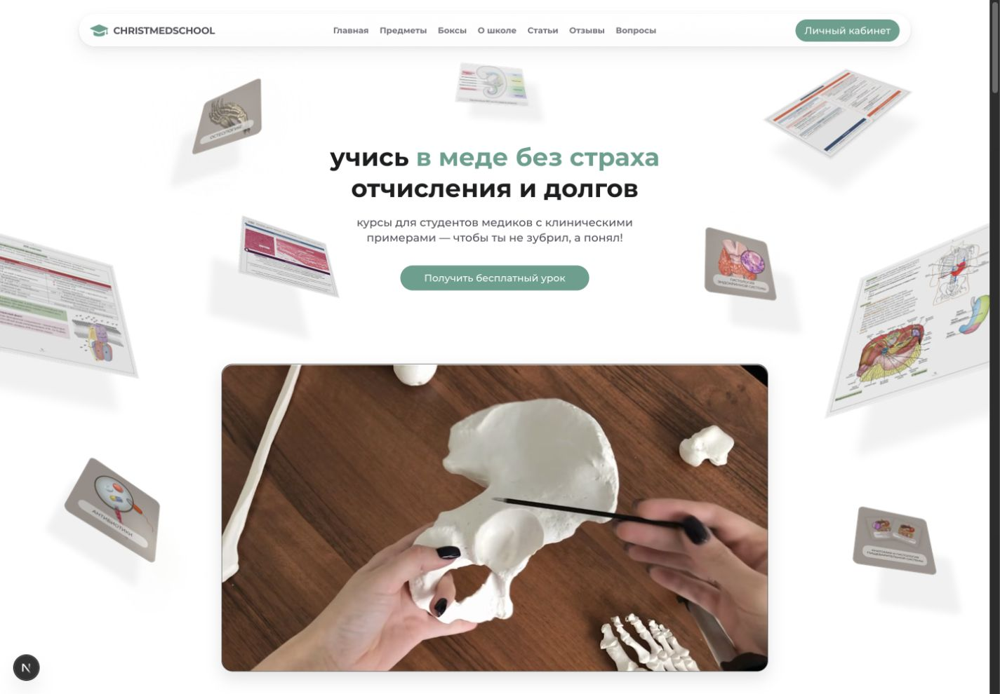
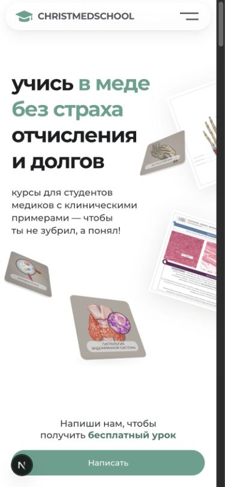
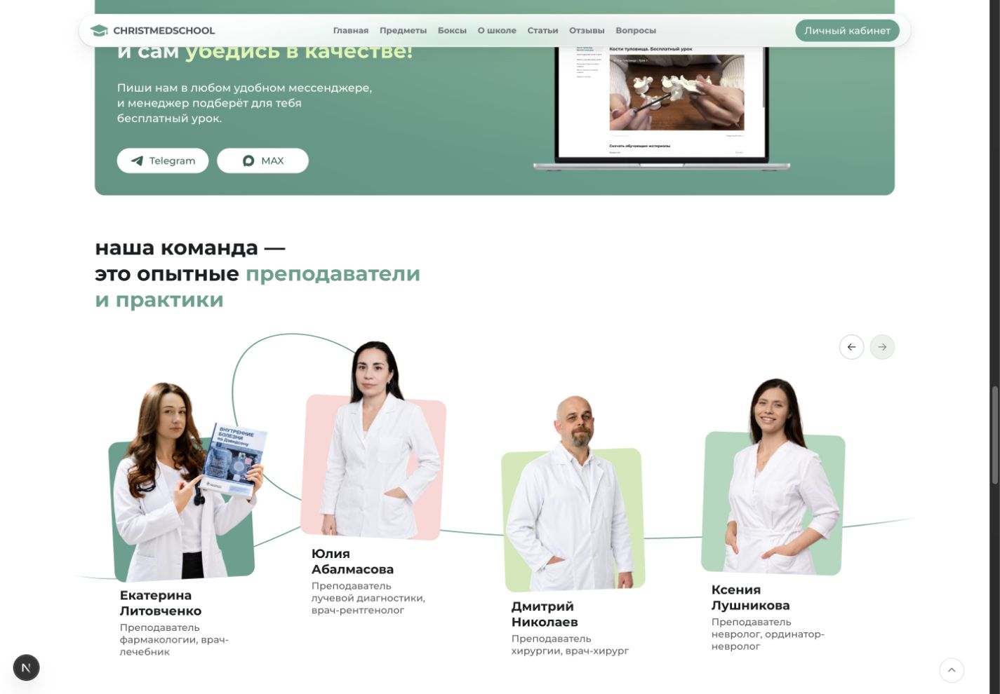
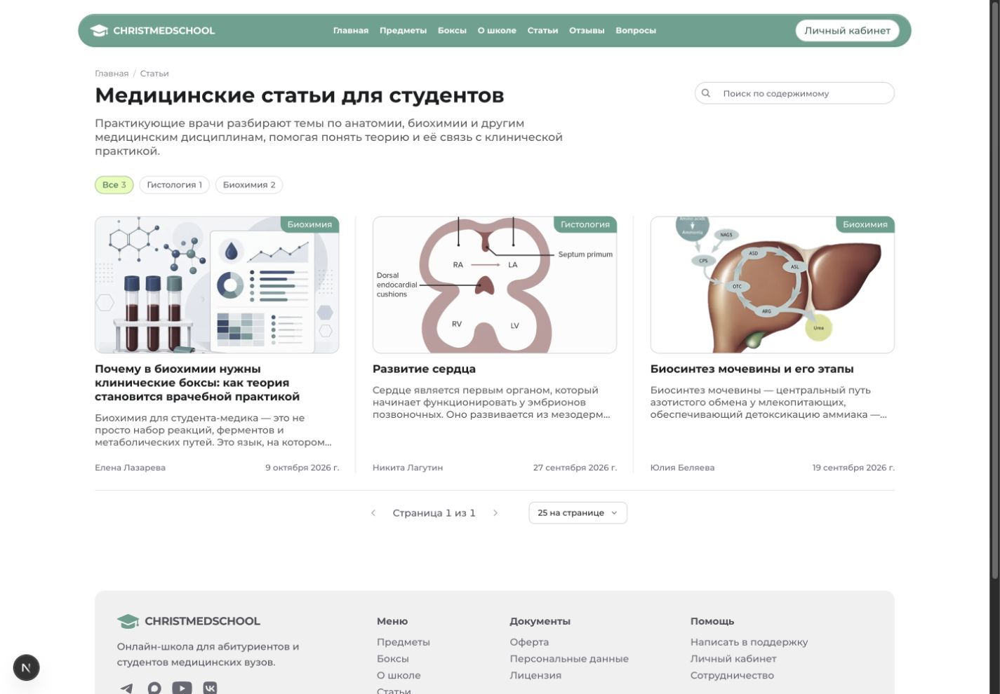

# LMS онлайн-школы

Коммерческая образовательная платформа для студентов медицинских вузов на Laravel и Next.js: публичный сайт, каталог курсов, кабинет студента и инструменты сотрудников.

Проект в разработке на завершающем этапе - осталось дописать публичную часть.

**Посмотреть сайт:** [staging.christmedschool.com](https://staging.christmedschool.com/). Это тестовое окружение нового сайта без проверки под нагрузкой.

Для знакомства с реализацией: [frontend Next.js](frontend/src), [backend Laravel](backend/app), [админка Filament](backend/app/Filament), [возможности платформы](#возможности-платформы). Для запуска у себя: [локальная демонстрация](#локальный-запуск).

## Интерфейс

Главная школы в локальной демонстрации:



| Главная на мобильном экране | Команда школы на широком экране |
| --- | --- |
|  |  |

Статьи как часть публичного сайта:



В демо доступны три полные статьи школы с обложками, иллюстрациями и авторами. Дополнительные снимки: [статья на широком экране](docs/images/lms-article-desktop.jpg), [статья на мобильном экране](docs/images/lms-article-mobile.jpg), [каталог на мобильном экране](docs/images/lms-articles-mobile.jpg), [поиск на мобильном экране](docs/images/lms-articles-search-mobile.jpg).

## Что охватывает проект

| Часть продукта | Реализация |
| --- | --- |
| Обучение | Предметы, курсы, уроки, задания, автоматическая и ручная проверка ответов |
| Продажи и доступ | Заказы, платежные адаптеры, webhooks, возвраты, бонусы и серверная выдача доступа |
| Административная панель | Пользователи, заказы, проверка заданий, поддержка, статьи, отзывы и вопросы |
| Публичный сайт | Главная, каталог предметов и курсов, команда, статьи, отзывы и вопросы |

## Архитектура

Версии зафиксированы в манифестах и файлах фиксации зависимостей этой копии:

| Слой | Технологии |
| --- | --- |
| Frontend | Next.js 16.3.3, React 19.2.4, TypeScript 5.9.3, Tailwind CSS 4.3.0 |
| Backend | PHP 8.5.12+, Laravel 13.16.1, Filament 5.10.1, Sanctum 4.3.2 |
| Данные коммерческого проекта | PostgreSQL, Redis для кеша, сессий и очередей |
| Локальная демонстрация | SQLite, файловые кеш и сессии, локальное хранилище, синхронная очередь |

Основные связи коммерческого приложения:

```text
Браузер ученика                          Браузер сотрудника
      |                                        |
      v                                        |
Next.js / React / TypeScript                    |
      | JSON / статусы                         |
      v                                        v
+---------------------- Laravel ------------------------+
| REST API                         Filament / Livewire  |
|      |                                  |            |
|      +------> Серверные сервисы <--------+            |
|               Eloquent для данных                    |
+------------------------+-----------------------------+
                         |
        +----------------+---------------------------+
        |                |                           |
        v                v                           v
   PostgreSQL       Redis / очереди           Платежные адаптеры
   контент, заказы,       |                    <--> provider API
   задания, доступы      v                    <-- webhooks
                    Обработчики задач
                         |
             +-----------+-----------+
             |                       |
             v                       v
        S3 public media        S3 private files
        статьи, отзывы         исходник -> персональная PDF
        варианты изображений   -> временная ссылка

Laravel -> JWT -> плеер Kinescope
Kinescope -> authorization callback -> Laravel -> проверка доступа
```

**Разделение ответственности.** Next.js получает данные через REST API Laravel. Filament и Livewire работают внутри Laravel и напрямую вызывают серверные сервисы. Общая бизнес-логика определяет состояние заказов и права на учебные материалы для кабинета, админки и внешних событий. Eloquent работает с данными PostgreSQL; Redis обслуживает кеш, сессии и очереди. Пример публичного запроса: [страница статей](frontend/src/app/(site)/articles/page.tsx) → [articlesApi](frontend/src/lib/articlesApi.ts) → [ArticleController](backend/app/Http/Controllers/Api/ArticleController.php).

**Публичные медиа и закрытые файлы.** [filesystems.php](backend/config/filesystems.php) разделяет публичные диски статей и отзывов и приватные диски исходников и подготовленных учебных файлов. Для редакционных изображений ведётся реестр: оригинал, варианты, ссылки из публикаций и авторов. [ArticleMediaLifecycle](backend/app/Services/Articles/ArticleMediaLifecycle.php) планирует удаление после транзакции, повторно проверяет ссылки и сохраняет неудачную попытку для повтора. Это защищает общие изображения от удаления при редактировании одной статьи.

Для учебного PDF [запрос на подготовку](backend/app/Services/ProtectedFiles/ProtectedFileDeliveryResponder.php) сначала проверяет право на материал и доверенный браузер. Задача [генерации](backend/app/Services/ProtectedFiles/ProtectedFileGenerator.php) сверяет исходник, создаёт персональную копию с кодом водяного знака и сохраняет её приватно. После подтверждения правил использования backend повторяет проверки и выдаёт [временную ссылку](backend/app/Services/ProtectedFiles/FilesystemTemporaryDownloadUrlIssuer.php). Удаление подготовленных объектов проходит через [отдельную задачу](backend/app/Services/ProtectedFiles/ProtectedFileOutputRemoval.php). Такой путь не раскрывает постоянный публичный адрес учебного исходника. Контракт описан в [ProtectedFileDeliveryApiTest](backend/tests/Feature/ProtectedFileDeliveryApiTest.php); работа реального S3 этим README не подтверждается.

**Видео Kinescope.** [LearningVideoController](backend/app/Http/Controllers/Api/LearningVideoController.php) проверяет принадлежность материала уроку, доступ и доверенный браузер перед запуском. [Сервис воспроизведения](backend/app/Services/Kinescope/KinescopeVideoPlaybackService.php) добавляет в embed URL параметр `drmauthtoken`. Это [подписанный JWT](backend/app/Services/Kinescope/JwtKinescopePlaybackToken.php) с пользователем, материалом, provider video ID и ограниченным сроком действия от 60 до 600 секунд; для платного урока в него входит сессия водяного знака. [Authorization callback](backend/app/Http/Controllers/Api/KinescopeAuthorizationController.php) аутентифицирует запрос через Basic Auth, проверяет токен, video ID, актуальный доступ и активную сессию водяного знака. Бесплатный preview обрабатывается отдельно. Повторная проверка связывает запуск с текущим правом пользователя; поведение отказов описано в [KinescopeAuthorizationCallbackTest](backend/tests/Feature/KinescopeAuthorizationCallbackTest.php). Локальная демонстрация показывает постеры и не проверяет воспроизведение у провайдера.

## Возможности платформы

### Платформа обучения с тестированием знаний

В [личном кабинете](frontend/src/app/(site)/lk/learning) обучение организовано по предметам, курсам и урокам. Ученик переходит между уроками, читает материалы, смотрит видео, получает учебные файлы и выполняет задания. Проверка знаний сочетает автоматическую оценку и проверку ответов сотрудником. Страницы Next.js получают структуру и состояние обучения через [Laravel API](frontend/src/lib/learningApi.ts).

Доступ к видео и файлам проверяется на backend. На странице урока эти механизмы представлены [плеером Kinescope](frontend/src/components/learning/KinescopeVideoPlayer.tsx) и [панелью получения защищённых файлов](frontend/src/components/learning/ProtectedFileDeliveryPanel.tsx). Их устройство раскрыто в разделе «Архитектура».

Пример более сложной логики внутри обучения — сохранение попыток и ручная проверка. Изменение задания после отправки ответа не должно менять смысл уже сохранённой попытки, а повтор запроса не должен создавать повторную оценку.

[LessonAssessmentAttemptService](backend/app/Services/Learning/LessonAssessmentAttemptService.php) связывает попытку с версией задания; после прохождения автоматической части ответы для ручной проверки переходят в `pending_review`. [LessonAssessmentManualReviewService](backend/app/Services/Learning/LessonAssessmentManualReviewService.php) проверяет полномочия и область ответственности сотрудника, использует ревизии и ключи идемпотентности, сохраняет события оценки и отдельно завершает проверку. Это позволяет отличать промежуточную работу преподавателя от итогового результата. [Интерфейс ученика](frontend/src/components/learning/LessonAssessment.tsx) и [страница сотрудника](backend/app/Filament/Pages/AssessmentReviewDetail.php) работают с этим контрактом.

Интерфейс задания различает запуск, ошибку и отказ в доступе; переходы описаны в [контроллере состояний](frontend/src/components/learning/lessonAssessmentController.ts). Сценарии сохранения и проверки ответов покрывают [LessonAssessmentHybridSubmissionTest](backend/tests/Feature/LessonAssessmentHybridSubmissionTest.php), [AdminLessonAssessmentReviewApiTest](backend/tests/Feature/AdminLessonAssessmentReviewApiTest.php) и [тесты интерфейса](frontend/src/components/learning/LessonAssessment.test.ts).

### Продажи и управление доступом

Подсистема связывает заказ, оплату и право на обучение. Laravel хранит состояние расчётов, обрабатывает события платёжного провайдера, выдаёт права и проверяет их при обращении к материалам. Сотрудники работают с заказами через [административную панель](backend/app/Filament/Pages/Operations/Orders.php).

Один из ключевых механизмов здесь — обработка повторных уведомлений и восстановление после сбоя выдачи доступа. Возврат пользователя из платёжной формы сам по себе не подтверждает оплату. Повторный webhook и ошибка выдачи доступа должны оставлять различимые состояния, чтобы можно было восстановить обработку.

[Контракт провайдера](backend/app/Contracts/Payments/PaymentProviderAdapter.php) отделён от заказа. Например, [CloudpaymentsWebhookHandler](backend/app/Services/Payments/CloudpaymentsWebhookHandler.php) сверяет сумму, валюту, попытку оплаты и повторные события. [OrderSettlementService](backend/app/Services/OrderSettlementService.php) фиксирует подтверждение расчёта с ключом идемпотентности, затем выдаёт права; статусы `pending_grant` и `grant_failed` сохраняют отличие оплаты от результата выдачи. [PaymentOutboxService](backend/app/Services/Payments/PaymentOutboxService.php) хранит задачи последующей обработки. [AccessResolver](backend/app/Services/AccessResolver.php) проверяет фактический доступ при обращении к контенту. Разделение нужно, чтобы успех платежа не терялся при отдельном сбое выдачи прав.

Контракты и отказные сценарии: [PaymentsApiTest](backend/tests/Feature/PaymentsApiTest.php), [PaymentOutboxRecoveryTest](backend/tests/Feature/PaymentOutboxRecoveryTest.php), [EntitlementEffectEvidenceTest](backend/tests/Feature/Payments/EntitlementEffectEvidenceTest.php). Платежи, webhooks и выдача доступа в рабочих интеграциях этой демонстрацией не проверяются.

### Административная панель и управление контентом

Панель на Filament объединяет работу с публичным контентом и повседневные задачи сотрудников: [пользователи](backend/app/Filament/Pages/Users.php), [заказы](backend/app/Filament/Pages/Operations/Orders.php), [проверка заданий](backend/app/Filament/Pages/AssessmentReviews.php) и [обращения в поддержку](backend/app/Filament/Pages/Operations/SupportTickets.php).

Для публичного сайта предусмотрены [статьи](backend/app/Filament/Pages/Articles.php), [отзывы](backend/app/Filament/Pages/Reviews/Reviews.php) и [вопросы](backend/app/Filament/Pages/Operations/Faqs.php). Сотрудники редактируют содержание и управляют его публикацией; посетители видят опубликованные материалы на соответствующих страницах Next.js. Frontend и административные части этих трёх разделов готовы.

Редактор статей показывает, как внутри этой системы решены работа с HTML, визуальное редактирование и предпросмотр без публикации черновика. Две вкладки не должны молча перезаписывать изменения, а удаление статьи не должно ломать изображение, которое использует другая публикация.

[Форма Filament](backend/app/Filament/Pages/Articles.php) работает с [ArticleEditor](backend/app/Services/Articles/ArticleEditor.php): сервис проверяет права, ревизию, нормализует HTML и фиксирует действие сотрудника. Редакционный автор хранится отдельно от аккаунта сотрудника. [Предпросмотр](backend/app/Services/Articles/ArticlePreview.php) готовит документ из текущей формы. Реестр медиа и отложенное удаление учитывают общие ссылки и повторные попытки очистки. Ревизия защищает от потери изменений, а серверный сервис объединяет правила сохранения и работы с файлами.

Примеры тестов: [ArticleEditorSystemTest](backend/tests/Feature/ArticleEditorSystemTest.php) проверяет сохранение и предпросмотр, [ArticleMediaLifecycleTest](backend/tests/Feature/ArticleMediaLifecycleTest.php) описывает общие файлы, удаление последней ссылки и сбой очистки.

### Публичный сайт

Публичная часть знакомит посетителя со школой и ведёт от выбора предмета к курсу. Она включает [главную](frontend/src/app/(site)/page.tsx), [каталог предметов и курсов](frontend/src/app/(site)/subjects), команду, [статьи](frontend/src/app/(site)/articles), [отзывы](frontend/src/app/(site)/reviews) и [вопросы](frontend/src/app/(site)/faq). Контент поступает из Laravel через API; публичные страницы и административные инструменты работают с общими данными.

Главная показывает чистый дизайн и адаптивную вёрстку. Общие [кнопки](frontend/src/components/button/Button.tsx), [карточки](frontend/src/components/content/SurfaceCard.tsx), [ссылки](frontend/src/components/content/TextLink.tsx) и [стили с токенами](frontend/src/app/globals.css) используются на разных страницах. Типизированные модули [каталога](frontend/src/lib/catalogApi.ts), [статей](frontend/src/lib/articlesApi.ts), [отзывов](frontend/src/lib/reviewsApi.ts) и [вопросов](frontend/src/lib/faqApi.ts) связывают интерфейс с backend. Это взаимодействие проверяют, например, [тесты API статей](frontend/src/lib/articlesApi.test.ts).

SEO оптимизация выполнена только для главной: [метаданные и структурированные данные](frontend/src/lib/homeSeo.ts), canonical и Open Graph. [Политика индексации](frontend/src/lib/siteIndexingPolicy.ts) управляет разрешением индексации. Статьи, отзывы и вопросы позволяют регулярно дополнять сайт содержанием и создают основу для дальнейшего развития поискового трафика.

## Карта кода

| Задача | С чего начать |
| --- | --- |
| Главная и каталог | [страница главной](frontend/src/app/(site)/page.tsx), [компоненты главной](frontend/src/components/home), [страницы предметов и курсов](frontend/src/app/(site)/subjects), [catalogApi](frontend/src/lib/catalogApi.ts) |
| Статьи, отзывы и вопросы | [страницы статей](frontend/src/app/(site)/articles), [отзывы](frontend/src/app/(site)/reviews), [вопросы](frontend/src/app/(site)/faq), [ArticleController](backend/app/Http/Controllers/Api/ArticleController.php), [маршруты API](backend/routes/api.php) |
| Административные интерфейсы | [статьи](backend/app/Filament/Pages/Articles.php), [отзывы](backend/app/Filament/Pages/Reviews), [вопросы](backend/app/Filament/Pages/Operations/Faqs.php), [проверка заданий](backend/app/Filament/Pages/AssessmentReviews.php) |
| Кабинет и обучение | [страницы обучения](frontend/src/app/(site)/lk/learning), [компоненты обучения](frontend/src/components/learning), [сервисы обучения](backend/app/Services/Learning) |
| Продажи и права | [платежные сервисы](backend/app/Services/Payments), [подтверждение расчёта](backend/app/Services/OrderSettlementService.php), [выдача прав](backend/app/Services/EntitlementGrantService.php), [проверка доступа](backend/app/Services/AccessResolver.php) |
| Типы, состояния и тесты frontend | [API и типы](frontend/src/lib), [тесты API статей](frontend/src/lib/articlesApi.test.ts), [тесты переходов задания](frontend/src/components/learning/lessonAssessmentController.test.ts) |
| Изоляция демонстрации | [demo.py](scripts/demo.py), [DemoSeeder](backend/database/seeders/DemoSeeder.php), [DemoReadOnly](backend/app/Http/Middleware/DemoReadOnly.php), [DemoPublicApiTest](backend/tests/Feature/DemoPublicApiTest.php) |

## Локальный запуск

Нужны PHP 8.5.12 или новее в ветке 8.x с расширениями из Composer и поддержкой PDO SQLite, Composer, Node.js 24.21.0 из `.node-version`, pnpm 11.x и Python 3.9+. Для проверки стандартов нужен `ripgrep` (`rg`). В `package.json` указан pnpm 11.19.0; подготовленная копия проверена с pnpm 11.25.0. Docker, PostgreSQL и Redis для демонстрации не нужны.

Все команды выполняются из корня этой копии:

```sh
python3 scripts/demo.py install
python3 scripts/demo.py setup
```

`install` устанавливает зависимости по файлам фиксации версий: Composer без плагинов и скриптов, pnpm с `--frozen-lockfile --ignore-scripts`. Каждый `setup` пересоздаёт базу `backend/database/demo.sqlite` через `migrate:fresh` и заполняет её публичными материалами школы. Все прежние записи этой демонстрационной базы удаляются. Команда также создаёт ссылку `backend/public/storage` только на локальный `backend/storage/app/public` и проверяет её адрес.

В первом терминале запустите серверную часть:

```sh
python3 scripts/demo.py backend
```

Во втором терминале, также из корня копии, запустите клиентскую часть:

```sh
python3 scripts/demo.py frontend
```

Откройте [http://127.0.0.1:3100/](http://127.0.0.1:3100/), выберите предмет на главной и перейдите к курсу. В [разделе статей](http://127.0.0.1:3100/articles) доступны поиск и полные публикации с изображениями и авторами. Данные поступают из локального Laravel API на `127.0.0.1:8100`.

В демо включены 14 предметов, 64 курса, 8 преподавателей, 18 отзывов, 6 вопросов и 3 статьи. Тексты и изображения хранятся локально. Видео представлены постерами; ссылки на открытые PDF ведут на staging.

Остановить каждый сервер можно через `Ctrl+C` в его терминале. Перед сборкой Next.js остановите его сервер разработки: они используют один каталог `.next`.

Рабочие `.env` и учётные данные не нужны. Скрипт использует включённые `.env.example` и изолированные настройки демо; изменения `.env` не переопределяют этот запуск.

## Проверки и ограничения

После установки зависимостей из корня копии:

```sh
python3 scripts/demo.py lint
python3 scripts/demo.py standards
python3 scripts/demo.py typecheck
python3 scripts/demo.py test-frontend
python3 scripts/demo.py test-backend
python3 scripts/demo.py build
```

Проверены линтер, стандарты, типы TypeScript, тесты frontend, выбранный набор тестов Laravel и сборка Next.js. В браузере проверены главная, переход к предмету и курсу, команда, мобильное меню, каталог статей, поиск и чтение публикации. Результаты и охват описаны в [VERIFICATION.md](docs/VERIFICATION.md).

Локальное демо работает только на чтение: аккаунтов, заказов и закрытых учебных материалов в базе нет. Платежи, Kinescope, S3, почта и подтверждение телефона через исходящий звонок пользователя не подключены. Соответствующий код и тесты доступны для изучения. Полный серверный набор, рабочие интеграции и поведение под нагрузкой в этой копии не проверены.

## Состав копии и права

Копия содержит frontend, backend и публичные материалы школы для локального запуска. Рабочие учётные данные, приватные данные и закрытые учебные материалы исключены. Подробности: [состав копии и источники материалов](docs/PUBLIC_COPY.md), [перечень файлов](docs/FILE_INVENTORY.json).

Это копия коммерческого проекта для демонстрации реализации. Лицензия на открытое использование кода не предоставлена; права на код, бренд и материалы не передаются этим README.
